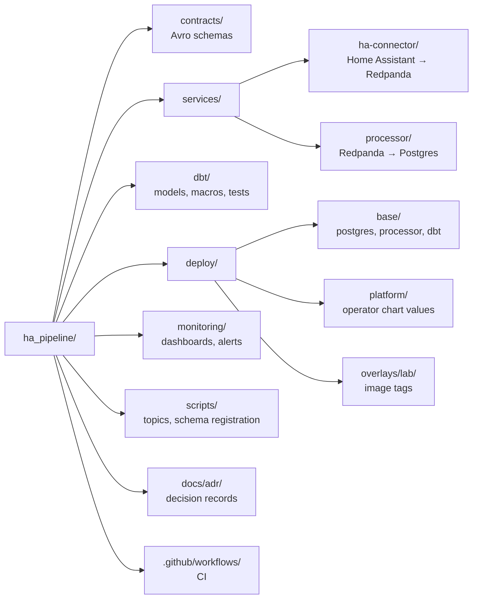
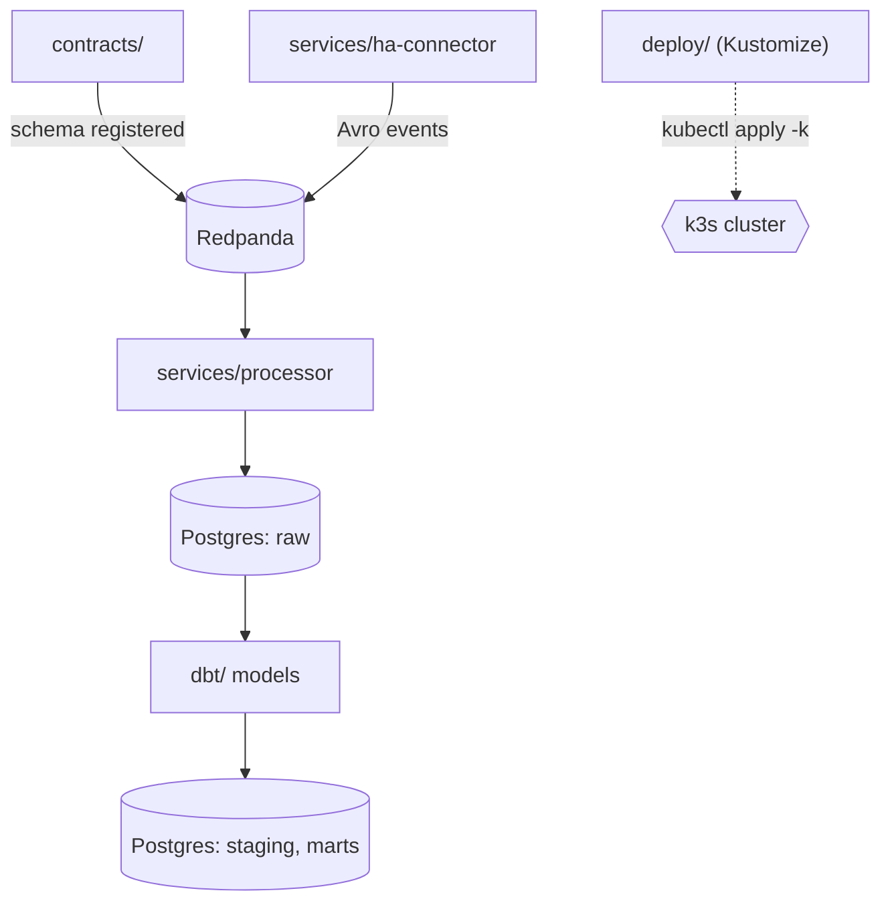

# ha_pipeline
Artifacts for ingest and management of Home Assistant telemetry.

## Background

I am running Home Assistant on a Raspberry Pi in my home network. For my own edification, I want to learn how to deploy monitoring of events recorded by HA. I am using this repo as a method for tracking my progress.

## Repo structure

This is the end-state structure for the repository - the resources are still WIP

### Folder map



### How the pieces fit together



### Directory tree

```text
ha_pipeline/
├── README.md
├── Makefile                        # render, validate, deploy, lock, images
├── .github/workflows/ci.yml        # lint, test, schema-compat, kubeconform, image build
├── contracts/
│   └── ha_state_changed/           # v1.avsc, COMPATIBILITY.md
├── docs/adr/                       # architecture decision records
├── services/
│   ├── ha-connector/               # Home Assistant WebSocket -> Redpanda
│   │   ├── src/ha_connector/
│   │   ├── tests/
│   │   ├── Dockerfile
│   │   ├── pyproject.toml
│   │   └── requirements.lock
│   └── processor/                  # Redpanda -> Postgres, dead-letter topic
│       ├── src/processor/
│       ├── tests/
│       ├── Dockerfile
│       ├── pyproject.toml
│       └── requirements.lock
├── dbt/
│   ├── dbt_project.yml
│   ├── macros/generate_schema_name.sql
│   ├── models/
│   │   ├── staging/                # sources.yml, stg_* views
│   │   └── marts/                  # dim_*, fact_* tables
│   ├── tests/
│   ├── Dockerfile
│   └── requirements.in / .lock
├── deploy/
│   ├── base/
│   │   ├── kustomization.yaml
│   │   ├── postgres/cluster.yaml
│   │   ├── processor/deployment.yaml
│   │   └── dbt/                    # cronjob.yaml, profiles.yml
│   ├── platform/cnpg/values.yaml   # operator overrides (chart version pinned in Makefile)
│   └── overlays/lab/kustomization.yaml
├── monitoring/
│   ├── dashboards/
│   └── alerts/
└── scripts/                        # create-topics.sh, register-schema.sh
```

